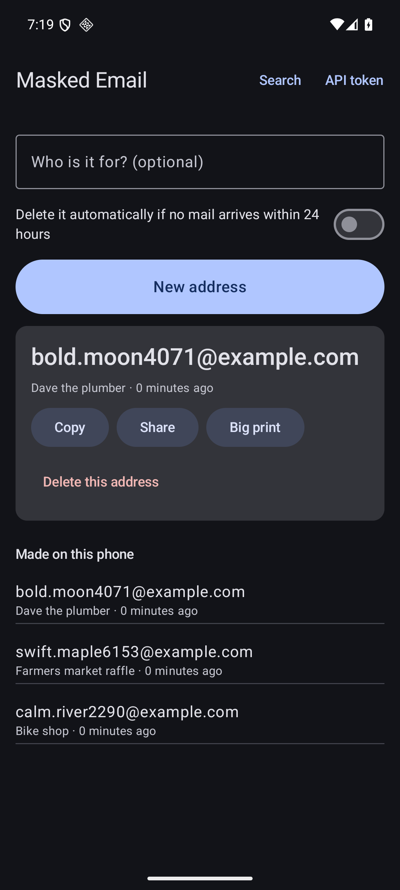
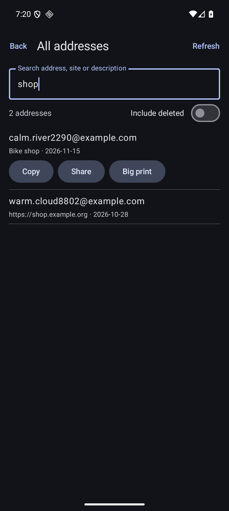

# Masked Email for Android

A small Android app that makes a new [Fastmail masked email](https://www.fastmail.com/features/masked-email/) address with one tap, so you can hand someone a fresh address on the spot: at a shop counter, on a paper form, to a contractor.

This is an unofficial app. It is not made or endorsed by Fastmail.

<p>
  
  
</p>


*Screenshots use made-up addresses on an emulator.*

## What it does

- **New address in one tap.** Optionally type who it is for; that becomes the address's description in Fastmail. The new address is shown large, copied to the clipboard, and can be sent with Share.
- **Big print.** Fills the screen with only the address, in landscape, at full brightness, as large as fits, for someone else to read off your phone. Letters are black, digits red and symbols blue, in a font with a dotted zero, so `0`/`O` and `1`/`l` are easy to tell apart.
- **Search.** Lists every masked address on your account, newest first, and filters by address, site or description as you type. Deleted addresses can be included.
- **Undo for an hour.** An address made on the phone can be deleted from the app for one hour afterwards. It is removed from Fastmail completely if it has never received mail; otherwise it is set to "deleted", so mail to it bounces.
- **Temporary addresses.** A switch creates the address in Fastmail's `pending` state: Fastmail deletes it by itself if no mail arrives within 24 hours.

Disabling addresses, and deleting older ones, is done in Fastmail itself.

## Setup

You need a Fastmail API token with the **Masked Email** scope and nothing else. Make one in Fastmail under Settings → Privacy & Security → Manage API tokens, and paste it into the app on first launch. The app checks it against Fastmail before saving it.

The token is encrypted with a key held in the Android Keystore, is excluded from device backups, and is sent only to `api.fastmail.com`. The app has no other network access, analytics or accounts.

## Build and install

Needs Android 13 or later, and the Android SDK (set `sdk.dir` in `local.properties`).

```sh
./gradlew assembleDebug
adb install -r app/build/outputs/apk/debug/app-debug.apk
```

## How it works

| Piece | File | Notes |
|---|---|---|
| Fastmail API | `Fastmail.kt` | JMAP over `HttpURLConnection`: session lookup, `MaskedEmail/get`, `MaskedEmail/set` |
| Storage | `Storage.kt` | The encrypted token, and the list of addresses made on this phone |
| UI | `MainActivity.kt` | Jetpack Compose: main, search, big print and token screens |

Sources are in `app/src/main/java/com/mbafford/maskedemail/`.

## License

MIT, see [LICENSE](LICENSE). The big print font is [JetBrains Mono](https://github.com/JetBrains/JetBrainsMono), under the SIL Open Font License ([licenses/JetBrainsMono-OFL.txt](licenses/JetBrainsMono-OFL.txt)).
